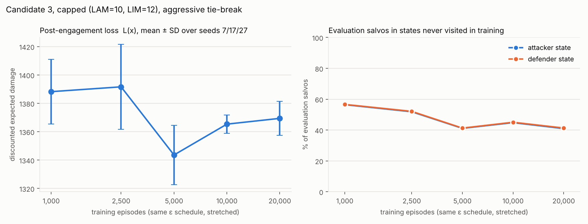

# Stage (c) robustness study — Tables 1–2, refinement, unvisited states, training length, loss decomposition

All runs: 30-asset instance (seed 7), T = 8, M = 64, B = 6, N_IM = 10, ω = 0.65, γ = 0.95, α = 0.10, ε linear 0.60 → 0.02, 1,000 training / 500 evaluation episodes unless stated, seeds 7, 17, 27; capped = LAM 10 / LIM 12. Trimming per Secs. 4.2–4.4; sourcing by PuLP/CBC with zero objective (DECISIONS D7–D8). The one free choice studied here is the arg-max tie-break (DECISIONS D10): **aggressive** is the primary rule; **random** and **lexicographic** are the alternatives. "Unvisited" means the evaluation state has no entry in the training-visited set, so every Q-value in its row is 0 and the tie-break alone decides the action.

## 1. Tables 1–2 under the three tie-break rules

### Rule: aggressive (primary; ties -> (2,2))

**Table 1 (uncapped)**

| Rank | Candidate | SAM sites | Covered | Mean loss | SD (seeds) | Per seed 7 / 17 / 27 | Paper mean | Paper rank |
|---|---|---|---|---|---|---|---|---|
| 1 | 0 | 0, 1, 2, 3, 8, 19 | 30 | 1367.97 | 27.53 | 1334.69 / 1367.12 / 1402.10 | 1346.07 | 1 |
| 2 | 1 | 9, 14, 19, 22, 26, 27 | 27 | 1393.90 | 19.73 | 1386.37 / 1420.92 / 1374.40 | 1406.98 | 3 |
| 3 | 3 | 7, 18, 19, 21, 23, 24 | 30 | 1403.40 | 11.76 | 1413.62 / 1409.66 / 1386.92 | 1363.67 | 2 |
| 4 | 4 | 2, 4, 12, 21, 22, 26 | 28 | 1409.75 | 34.87 | 1427.74 / 1440.52 / 1360.99 | 1407.77 | 4 |
| 5 | 2 | 9, 19, 20, 22, 26, 27 | 27 | 1439.47 | 27.36 | 1439.75 / 1405.83 / 1472.84 | 1441.00 | 5 |

**Table 2 (capped, LAM 10 / LIM 12)**

| Rank | Candidate | SAM sites | Covered | Mean loss | SD (seeds) | Per seed 7 / 17 / 27 | Paper mean | Paper rank |
|---|---|---|---|---|---|---|---|---|
| 1 | 3 | 7, 18, 19, 21, 23, 24 | 30 | 1388.22 | 22.74 | 1356.20 / 1401.55 / 1406.89 | 1363.04 | 1 |
| 2 | 4 | 2, 4, 12, 21, 22, 26 | 28 | 1399.86 | 14.25 | 1387.19 / 1392.62 / 1419.77 | 1399.72 | 2 |
| 3 | 1 | 9, 14, 19, 22, 26, 27 | 27 | 1400.58 | 1.54 | 1399.94 / 1399.11 / 1402.70 | 1438.17 | 5 |
| 4 | 0 | 0, 1, 2, 3, 8, 19 | 30 | 1401.33 | 40.31 | 1456.55 / 1385.99 / 1361.45 | 1401.34 | 3 |
| 5 | 2 | 9, 19, 20, 22, 26, 27 | 27 | 1408.33 | 32.39 | 1388.08 / 1454.04 / 1382.87 | 1419.94 | 4 |

- (a) Candidate 0 best uncapped: **YES** (best = Candidate 0, 1367.97).
- (b) Candidate 3 best capped: **YES** (best = Candidate 3, 1388.22).
- (c) Ranking flip between environments: **YES** (uncapped order [0, 1, 3, 4, 2], capped order [3, 4, 1, 0, 2]; paper: uncapped [0, 3, 1, 4, 2], capped [3, 4, 0, 2, 1]).
- Margin of the best over the runner-up: uncapped 25.93 (best's seed SD 27.53), capped 11.64 (seed SD 22.74).

### Rule: random (uniform over ties)

**Table 1 (uncapped)**

| Rank | Candidate | SAM sites | Covered | Mean loss | SD (seeds) | Per seed 7 / 17 / 27 | Paper mean | Paper rank |
|---|---|---|---|---|---|---|---|---|
| 1 | 3 | 7, 18, 19, 21, 23, 24 | 30 | 1263.78 | 30.61 | 1249.52 / 1235.51 / 1306.30 | 1363.67 | 2 |
| 2 | 0 | 0, 1, 2, 3, 8, 19 | 30 | 1280.54 | 35.61 | 1266.54 / 1245.64 / 1329.44 | 1346.07 | 1 |
| 3 | 2 | 9, 19, 20, 22, 26, 27 | 27 | 1300.96 | 20.54 | 1311.10 / 1272.31 / 1319.45 | 1441.00 | 5 |
| 4 | 1 | 9, 14, 19, 22, 26, 27 | 27 | 1316.06 | 36.41 | 1295.23 / 1367.25 / 1285.69 | 1406.98 | 3 |
| 5 | 4 | 2, 4, 12, 21, 22, 26 | 28 | 1361.82 | 15.84 | 1376.91 / 1368.61 / 1339.93 | 1407.77 | 4 |

**Table 2 (capped, LAM 10 / LIM 12)**

| Rank | Candidate | SAM sites | Covered | Mean loss | SD (seeds) | Per seed 7 / 17 / 27 | Paper mean | Paper rank |
|---|---|---|---|---|---|---|---|---|
| 1 | 0 | 0, 1, 2, 3, 8, 19 | 30 | 1226.39 | 7.86 | 1235.20 / 1216.12 / 1227.84 | 1401.34 | 3 |
| 2 | 4 | 2, 4, 12, 21, 22, 26 | 28 | 1229.27 | 23.22 | 1262.12 / 1212.59 / 1213.12 | 1399.72 | 2 |
| 3 | 3 | 7, 18, 19, 21, 23, 24 | 30 | 1237.14 | 17.55 | 1260.40 / 1233.01 / 1218.01 | 1363.04 | 1 |
| 4 | 1 | 9, 14, 19, 22, 26, 27 | 27 | 1276.58 | 5.08 | 1273.22 / 1283.76 / 1272.76 | 1438.17 | 5 |
| 5 | 2 | 9, 19, 20, 22, 26, 27 | 27 | 1297.18 | 33.28 | 1273.52 / 1273.78 / 1344.25 | 1419.94 | 4 |

- (a) Candidate 0 best uncapped: **NO** (best = Candidate 3, 1263.78).
- (b) Candidate 3 best capped: **NO** (best = Candidate 0, 1226.39).
- (c) Ranking flip between environments: **YES** (uncapped order [3, 0, 2, 1, 4], capped order [0, 4, 3, 1, 2]; paper: uncapped [0, 3, 1, 4, 2], capped [3, 4, 0, 2, 1]).
- Margin of the best over the runner-up: uncapped 16.77 (best's seed SD 30.61), capped 2.89 (seed SD 7.86).

### Rule: lexicographic (ties -> (0,0))

**Table 1 (uncapped)**

| Rank | Candidate | SAM sites | Covered | Mean loss | SD (seeds) | Per seed 7 / 17 / 27 | Paper mean | Paper rank |
|---|---|---|---|---|---|---|---|---|
| 1 | 0 | 0, 1, 2, 3, 8, 19 | 30 | 814.66 | 171.13 | 679.48 / 1056.11 / 708.41 | 1346.07 | 1 |
| 2 | 2 | 9, 19, 20, 22, 26, 27 | 27 | 833.34 | 114.09 | 907.03 / 920.80 / 672.20 | 1441.00 | 5 |
| 3 | 3 | 7, 18, 19, 21, 23, 24 | 30 | 860.64 | 160.34 | 999.52 / 946.42 / 635.97 | 1363.67 | 2 |
| 4 | 1 | 9, 14, 19, 22, 26, 27 | 27 | 895.06 | 258.39 | 1064.85 / 1090.39 / 529.94 | 1406.98 | 3 |
| 5 | 4 | 2, 4, 12, 21, 22, 26 | 28 | 895.48 | 120.76 | 887.96 / 1047.00 / 751.49 | 1407.77 | 4 |

**Table 2 (capped, LAM 10 / LIM 12)**

| Rank | Candidate | SAM sites | Covered | Mean loss | SD (seeds) | Per seed 7 / 17 / 27 | Paper mean | Paper rank |
|---|---|---|---|---|---|---|---|---|
| 1 | 3 | 7, 18, 19, 21, 23, 24 | 30 | 884.73 | 102.91 | 952.18 / 962.69 / 739.32 | 1363.04 | 1 |
| 2 | 0 | 0, 1, 2, 3, 8, 19 | 30 | 897.62 | 98.09 | 806.48 / 1033.75 / 852.61 | 1401.34 | 3 |
| 3 | 2 | 9, 19, 20, 22, 26, 27 | 27 | 950.08 | 130.27 | 1098.36 / 970.64 / 781.25 | 1419.94 | 4 |
| 4 | 4 | 2, 4, 12, 21, 22, 26 | 28 | 950.34 | 112.73 | 1079.50 / 804.83 / 966.68 | 1399.72 | 2 |
| 5 | 1 | 9, 14, 19, 22, 26, 27 | 27 | 1001.23 | 93.56 | 1101.39 / 1026.00 / 876.28 | 1438.17 | 5 |

- (a) Candidate 0 best uncapped: **YES** (best = Candidate 0, 814.66).
- (b) Candidate 3 best capped: **YES** (best = Candidate 3, 884.73).
- (c) Ranking flip between environments: **YES** (uncapped order [0, 2, 3, 1, 4], capped order [3, 0, 2, 4, 1]; paper: uncapped [0, 3, 1, 4, 2], capped [3, 4, 0, 2, 1]).
- Margin of the best over the runner-up: uncapped 18.68 (best's seed SD 171.13), capped 12.88 (seed SD 102.91).

## 2. Swap-neighbourhood refinement (Algorithm 2) under each rule

Start = that rule's capped best. Each iteration evaluates all 144 one-battery swap neighbours with the same 3-seed protocol and moves to the best neighbour if its mean loss is strictly lower (best-improvement, DECISIONS D14); it stops when no neighbour improves. Paper (Sec. 5.2): Candidate 3 → swap 21→12 (1363.04 → 1320.85) → swap 24→3 (→ 1318.71) → final {3, 7, 12, 18, 19, 23}, 28 assets covered, 3.25% reduction.

### Rule: aggressive (primary; ties -> (2,2))

| Iteration | Incumbent | Swap | Best neighbour | Covered | Mean loss | SD | Outcome |
|---|---|---|---|---|---|---|---|
| 0 | {7, 18, 19, 21, 23, 24} | — | {7, 18, 19, 21, 23, 24} | 30 | 1388.22 | 22.74 | start |
| 1 | {7, 18, 19, 21, 23, 24} | 19→13 | {7, 13, 18, 21, 23, 24} | 30 | 1349.78 | 3.94 | accepted |
| 2 | {7, 13, 18, 21, 23, 24} | 23→8 | {7, 8, 13, 18, 21, 24} | 30 | 1346.63 | 9.43 | accepted |
| 3 | {7, 8, 13, 18, 21, 24} | 24→16 | {7, 8, 13, 16, 18, 21} | 28 | 1336.02 | 8.16 | accepted |
| 4 | {7, 8, 13, 16, 18, 21} | 16→29 | {7, 8, 13, 18, 21, 29} | 28 | 1336.57 | 7.78 | rejected (no improving neighbour) -> stop |

- Final allocation {7, 8, 13, 16, 18, 21} covering 28 assets, mean loss 1336.02 (start 1388.22, reduction 3.76%). Reaches the paper's {3, 7, 12, 18, 19, 23}: **NO**.
  - iteration 1, three best neighbours: 19→13 = 1349.78 ± 3.94; 23→25 = 1350.24 ± 1.53; 24→20 = 1351.77 ± 16.46
  - iteration 2, three best neighbours: 23→8 = 1346.63 ± 9.43; 24→29 = 1349.60 ± 26.88; 23→6 = 1350.57 ± 12.38
  - iteration 3, three best neighbours: 24→16 = 1336.02 ± 8.16; 24→29 = 1336.57 ± 7.78; 18→9 = 1340.69 ± 6.63
  - iteration 4, three best neighbours: 16→29 = 1336.57 ± 7.78; 13→12 = 1337.57 ± 15.03; 8→3 = 1338.22 ± 11.56

### Rule: random (uniform over ties)

| Iteration | Incumbent | Swap | Best neighbour | Covered | Mean loss | SD | Outcome |
|---|---|---|---|---|---|---|---|
| 0 | {0, 1, 2, 3, 8, 19} | — | {0, 1, 2, 3, 8, 19} | 30 | 1226.39 | 7.86 | start |
| 1 | {0, 1, 2, 3, 8, 19} | 19→6 | {0, 1, 2, 3, 6, 8} | 30 | 1203.35 | 40.11 | accepted |
| 2 | {0, 1, 2, 3, 6, 8} | 8→24 | {0, 1, 2, 3, 6, 24} | 30 | 1194.00 | 37.85 | accepted |
| 3 | {0, 1, 2, 3, 6, 24} | 2→29 | {0, 1, 3, 6, 24, 29} | 30 | 1175.59 | 31.58 | accepted |
| 4 | {0, 1, 3, 6, 24, 29} | 1→5 | {0, 3, 5, 6, 24, 29} | 30 | 1185.47 | 43.83 | rejected (no improving neighbour) -> stop |

- Final allocation {0, 1, 3, 6, 24, 29} covering 30 assets, mean loss 1175.59 (start 1226.39, reduction 4.14%). Reaches the paper's {3, 7, 12, 18, 19, 23}: **NO**.
  - iteration 1, three best neighbours: 19→6 = 1203.35 ± 40.11; 19→7 = 1206.13 ± 28.48; 19→5 = 1214.44 ± 9.07
  - iteration 2, three best neighbours: 8→24 = 1194.00 ± 37.85; 2→18 = 1204.65 ± 19.06; 6→7 = 1206.13 ± 28.48
  - iteration 3, three best neighbours: 2→29 = 1175.59 ± 31.58; 1→21 = 1182.93 ± 32.30; 0→17 = 1198.90 ± 8.97
  - iteration 4, three best neighbours: 1→5 = 1185.47 ± 43.83; 29→2 = 1194.00 ± 37.85; 1→12 = 1198.51 ± 31.88

### Rule: lexicographic (ties -> (0,0))

| Iteration | Incumbent | Swap | Best neighbour | Covered | Mean loss | SD | Outcome |
|---|---|---|---|---|---|---|---|
| 0 | {7, 18, 19, 21, 23, 24} | — | {7, 18, 19, 21, 23, 24} | 30 | 884.73 | 102.91 | start |
| 1 | {7, 18, 19, 21, 23, 24} | 7→20 | {18, 19, 20, 21, 23, 24} | 28 | 812.14 | 101.32 | accepted |
| 2 | {18, 19, 20, 21, 23, 24} | 23→25 | {18, 19, 20, 21, 24, 25} | 28 | 681.24 | 90.60 | accepted |
| 3 | {18, 19, 20, 21, 24, 25} | 24→1 | {1, 18, 19, 20, 21, 25} | 28 | 684.26 | 105.37 | rejected (no improving neighbour) -> stop |

- Final allocation {18, 19, 20, 21, 24, 25} covering 28 assets, mean loss 681.24 (start 884.73, reduction 23.00%). Reaches the paper's {3, 7, 12, 18, 19, 23}: **NO**.
  - iteration 1, three best neighbours: 7→20 = 812.14 ± 101.32; 18→17 = 818.14 ± 84.22; 24→14 = 822.89 ± 73.91
  - iteration 2, three best neighbours: 23→25 = 681.24 ± 90.60; 21→28 = 772.79 ± 53.90; 21→15 = 774.46 ± 53.20
  - iteration 3, three best neighbours: 24→1 = 684.26 ± 105.37; 21→8 = 710.71 ± 88.59; 18→16 = 714.05 ± 80.61

## 3. Unvisited-state diagnostic

Fractions over the 500 evaluation episodes (4,000 salvos) of each run, averaged over the three seeds. "Salvo" = share of evaluation salvos whose state was never visited in training; "episode" = share of evaluation episodes with at least one such salvo. The defender state is (attacker state, a_t), so it is unvisited whenever the attacker state is, and sometimes also when it is not.

| Rule | Env | Candidate | Attacker: salvo | Defender: salvo | Attacker: episode | Defender: episode | Unique attacker states | Q^A entries | Q^D entries |
|---|---|---|---|---|---|---|---|---|---|
| aggressive | uncapped | 0 | 53.8% | 54.3% | 100.0% | 100.0% | 5593 | 5855 | 6098 |
| aggressive | uncapped | 1 | 52.0% | 52.7% | 99.9% | 99.9% | 5407 | 5730 | 6014 |
| aggressive | uncapped | 2 | 47.6% | 48.2% | 99.9% | 99.9% | 5327 | 5653 | 5933 |
| aggressive | uncapped | 3 | 59.5% | 60.1% | 100.0% | 100.0% | 5747 | 5985 | 6209 |
| aggressive | uncapped | 4 | 55.8% | 56.3% | 100.0% | 100.0% | 5616 | 5891 | 6153 |
| aggressive | capped | 0 | 55.5% | 55.8% | 100.0% | 100.0% | 5548 | 5778 | 6023 |
| aggressive | capped | 1 | 46.4% | 47.0% | 99.8% | 99.9% | 5356 | 5660 | 5937 |
| aggressive | capped | 2 | 50.6% | 51.1% | 99.9% | 100.0% | 5479 | 5748 | 6012 |
| aggressive | capped | 3 | 56.4% | 56.6% | 100.0% | 100.0% | 5638 | 5875 | 6107 |
| aggressive | capped | 4 | 56.1% | 56.4% | 100.0% | 100.0% | 5680 | 5903 | 6131 |
| random | uncapped | 0 | 67.3% | 68.7% | 100.0% | 100.0% | 6226 | 6413 | 6573 |
| random | uncapped | 1 | 57.4% | 59.1% | 99.8% | 99.8% | 5917 | 6129 | 6302 |
| random | uncapped | 2 | 66.2% | 67.6% | 100.0% | 100.0% | 6105 | 6310 | 6486 |
| random | uncapped | 3 | 61.4% | 62.4% | 99.7% | 99.9% | 5954 | 6144 | 6327 |
| random | uncapped | 4 | 67.8% | 69.7% | 100.0% | 100.0% | 6061 | 6247 | 6407 |
| random | capped | 0 | 59.4% | 60.2% | 100.0% | 100.0% | 5623 | 5875 | 6110 |
| random | capped | 1 | 59.3% | 60.6% | 99.7% | 99.9% | 5760 | 5995 | 6221 |
| random | capped | 2 | 62.0% | 63.3% | 99.9% | 100.0% | 5875 | 6085 | 6290 |
| random | capped | 3 | 55.4% | 56.4% | 99.9% | 100.0% | 5571 | 5784 | 6009 |
| random | capped | 4 | 51.3% | 52.6% | 99.9% | 100.0% | 5574 | 5813 | 6052 |
| lexicographic | uncapped | 0 | 50.9% | 51.0% | 77.7% | 78.6% | 5605 | 5811 | 6034 |
| lexicographic | uncapped | 1 | 45.1% | 45.2% | 73.4% | 74.1% | 5761 | 5971 | 6182 |
| lexicographic | uncapped | 2 | 54.8% | 55.0% | 80.9% | 81.9% | 5999 | 6180 | 6373 |
| lexicographic | uncapped | 3 | 42.2% | 42.3% | 71.4% | 72.3% | 5613 | 5823 | 6058 |
| lexicographic | uncapped | 4 | 48.5% | 48.6% | 79.7% | 79.8% | 5782 | 5985 | 6211 |
| lexicographic | capped | 0 | 40.5% | 40.7% | 71.2% | 72.1% | 5353 | 5613 | 5890 |
| lexicographic | capped | 1 | 35.0% | 35.2% | 70.3% | 71.2% | 5102 | 5386 | 5679 |
| lexicographic | capped | 2 | 36.8% | 37.1% | 73.1% | 74.5% | 5156 | 5429 | 5719 |
| lexicographic | capped | 3 | 37.7% | 37.8% | 70.9% | 71.3% | 5220 | 5485 | 5768 |
| lexicographic | capped | 4 | 40.0% | 40.3% | 72.4% | 73.9% | 5177 | 5434 | 5721 |

Refinement runs (all neighbours, all rules) show the same pattern; their per-run values are in `refinement_trace.csv` and the per-seed JSON files under `results/raw/refine__*`.

## 4. Training-length sweep (Candidate 3, capped, aggressive rule)

| Training episodes | Mean loss | SD (seeds) | Per seed | Unvisited attacker (salvo) | Unvisited defender (salvo) | Unvisited attacker (episode) | Unvisited defender (episode) | Unique attacker states | Q^A entries | Q^D entries | Wall s/run |
|---|---|---|---|---|---|---|---|---|---|---|---|
| 1,000 | 1388.22 | 22.74 | 1356.20 / 1401.55 / 1406.89 | 56.4% | 56.6% | 100.0% | 100.0% | 5638 | 5875 | 6107 | 43 |
| 2,500 | 1391.62 | 29.84 | 1433.19 / 1364.58 / 1377.08 | 51.8% | 52.1% | 99.7% | 99.7% | 13548 | 14132 | 14713 | 85 |
| 5,000 | 1343.60 | 20.95 | 1315.32 / 1365.39 / 1350.09 | 41.1% | 41.3% | 99.8% | 99.8% | 24979 | 26246 | 27420 | 146 |
| 10,000 | 1365.33 | 6.52 | 1358.17 / 1363.88 / 1373.95 | 44.8% | 45.0% | 99.9% | 99.9% | 49170 | 51684 | 54077 | 226 |
| 20,000 | 1369.40 | 11.89 | 1352.90 / 1380.49 / 1374.80 | 40.9% | 41.3% | 99.2% | 99.2% | 94811 | 100118 | 105111 | 306 |

## 5. Loss decomposition: visited vs unvisited salvos

Per evaluation episode, the discounted damage Σ γ^(t−1) D_t is split by whether the salvo's attacker state (and, separately, defender state) was visited in training; values are per-episode means. Candidate 3, capped, 1,000 training episodes.

| Rule | Seed | Total loss | Visited-A salvos | Unvisited-A salvos | Share unvisited-A | Visited-D salvos | Unvisited-D salvos | Share unvisited-D |
|---|---|---|---|---|---|---|---|---|
| aggressive | 7 | 1356.20 | 739.58 | 616.62 | 45.5% | 737.80 | 618.40 | 45.6% |
| aggressive | 17 | 1401.55 | 953.02 | 448.53 | 32.0% | 952.29 | 449.26 | 32.1% |
| aggressive | 27 | 1406.89 | 860.19 | 546.70 | 38.9% | 858.70 | 548.19 | 39.0% |
| aggressive | mean | 1388.22 | 850.93 | 537.28 | 38.7% | 849.60 | 538.62 | 38.8% |
| random | 7 | 1260.40 | 1021.03 | 239.37 | 19.0% | 1013.38 | 247.03 | 19.6% |
| random | 17 | 1233.01 | 842.09 | 390.92 | 31.7% | 835.81 | 397.19 | 32.2% |
| random | 27 | 1218.01 | 729.16 | 488.85 | 40.1% | 714.64 | 503.37 | 41.3% |
| random | mean | 1237.14 | 864.09 | 373.05 | 30.2% | 854.61 | 382.53 | 30.9% |
| lexicographic | 7 | 952.18 | 952.18 | 0.00 | 0.0% | 952.18 | 0.00 | 0.0% |
| lexicographic | 17 | 962.69 | 962.69 | 0.00 | 0.0% | 962.69 | 0.00 | 0.0% |
| lexicographic | 27 | 739.32 | 739.32 | 0.00 | 0.0% | 739.32 | 0.00 | 0.0% |
| lexicographic | mean | 884.73 | 884.73 | 0.00 | 0.0% | 884.73 | 0.00 | 0.0% |

Same decomposition along the training-length sweep (aggressive rule, means over seeds):

| Training episodes | Total | Unvisited-A salvos | Share | Unvisited-D salvos | Share |
|---|---|---|---|---|---|
| 1,000 | 1388.22 | 537.28 | 38.7% | 538.62 | 38.8% |
| 2,500 | 1391.62 | 503.38 | 36.2% | 505.36 | 36.3% |
| 5,000 | 1343.60 | 366.01 | 27.2% | 367.45 | 27.3% |
| 10,000 | 1365.33 | 441.64 | 32.3% | 443.49 | 32.5% |
| 20,000 | 1369.40 | 395.13 | 28.9% | 397.33 | 29.0% |

## What changes if the rule changes

| Paper conclusion | aggressive | random | lexicographic | Verdict |
|---|---|---|---|---|
| Candidate 0 is the best uncapped allocation (paper Table 1) | held | NOT held | held | depends on the rule |
| Candidate 3 is the best capped allocation (paper Table 2) | held | NOT held | held | depends on the rule |
| The best allocation differs between the uncapped and capped environments (ranking flip) | held | held | held | robust to the rule |
| Candidates 0 and 3 (the two full-coverage plans) are the two best uncapped allocations (paper Table 1) | NOT held | held | NOT held | depends on the rule |
| Candidate 4 is the capped runner-up (paper Table 2) | held | held | NOT held | depends on the rule |
| Capped best beats the runner-up by more than one seed SD (ranking statistically resolvable at 3 seeds) | NOT held | NOT held | NOT held | fails under every rule |
| Loss magnitude within 5% of the paper's best-capped value 1363.04 | held | NOT held | NOT held | depends on the rule |
| Swap refinement improves on the capped best (at least one accepted swap) | held | held | held | robust to the rule |
| Refinement reaches the paper's final plan {3, 7, 12, 18, 19, 23} | NOT held | NOT held | NOT held | fails under every rule |
| The refined plan covers fewer than 30 assets (coverage alone does not rank allocations) | held | NOT held | held | depends on the rule |

Why the rule matters: at 1,000 training episodes the greedy evaluation spends roughly 56% (aggressive), 59% (random) and 38% (lexicographic) of its salvos in attacker states the training never reached, and in those salvos the action is the tie-break, not a learned value. Under the aggressive rule about a third of the reported loss is generated in such salvos; under the lexicographic rule they generate none (no attack), which is why its losses are ~35% lower and far noisier across seeds. Training 20x longer only reduces the unvisited share to ~41%, because the reachable (z, m, q) space keeps growing with the Q-tables (100k entries at 20,000 episodes), so the effect is structural rather than a matter of under-training.

Refinement: all three rules accept swaps, but each ends in a different plan and none reaches the manuscript's {3, 7, 12, 18, 19, 23}. The accepted improvements (3–19 loss units under the primary rule) are of the same order as the 3-seed standard deviations (4–27), so the refinement path is set largely by learning noise; the qualitative claim that swap refinement lowers the loss of the best initial candidate does hold under every rule.

Held under all three rules: The best allocation differs between the uncapped and capped environments (ranking flip); Swap refinement improves on the capped best (at least one accepted swap).

Not held under at least one rule: Candidate 0 is the best uncapped allocation (paper Table 1) (held only under: aggressive, lexicographic); Candidate 3 is the best capped allocation (paper Table 2) (held only under: aggressive, lexicographic); Candidates 0 and 3 (the two full-coverage plans) are the two best uncapped allocations (paper Table 1) (held only under: random); Candidate 4 is the capped runner-up (paper Table 2) (held only under: aggressive, random); Capped best beats the runner-up by more than one seed SD (ranking statistically resolvable at 3 seeds) (held only under: none); Loss magnitude within 5% of the paper's best-capped value 1363.04 (held only under: aggressive); Refinement reaches the paper's final plan {3, 7, 12, 18, 19, 23} (held only under: none); The refined plan covers fewer than 30 assets (coverage alone does not rank allocations) (held only under: aggressive, lexicographic).
